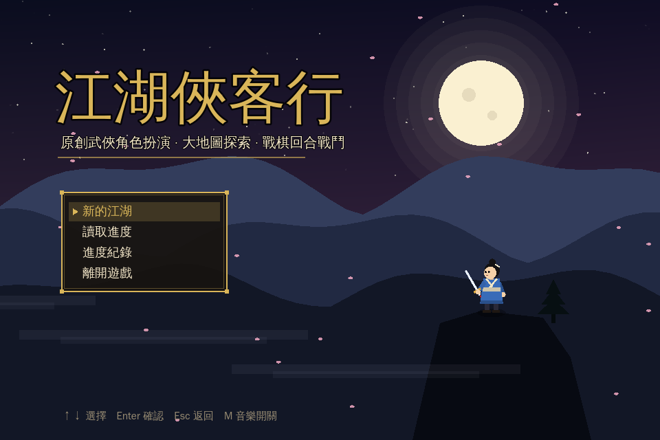
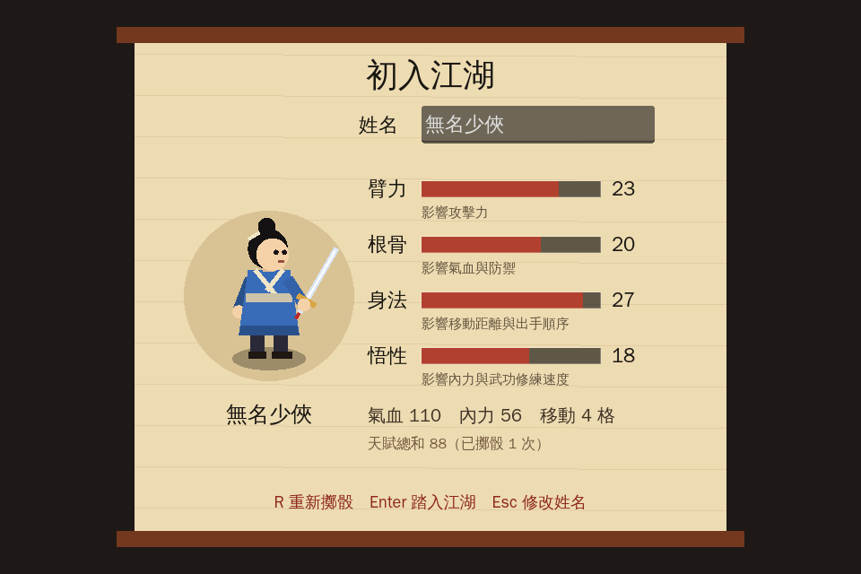
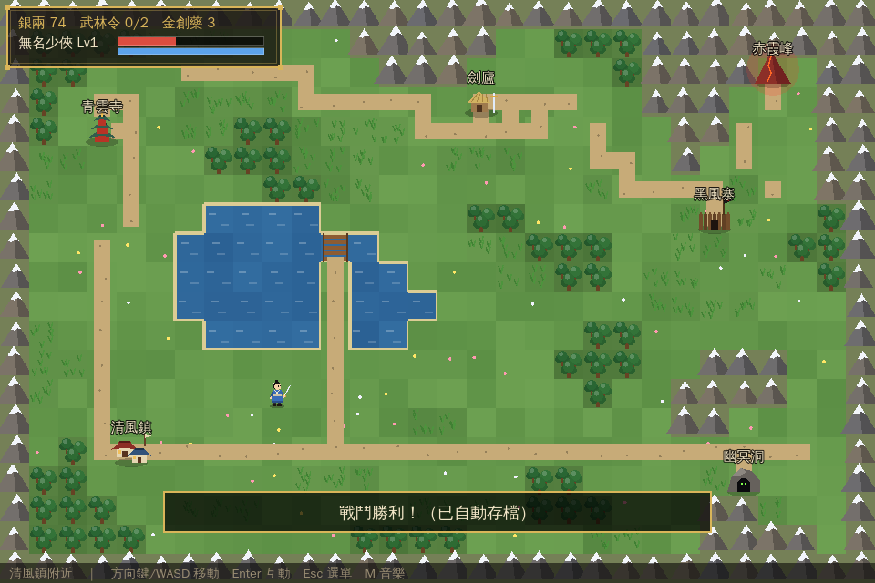
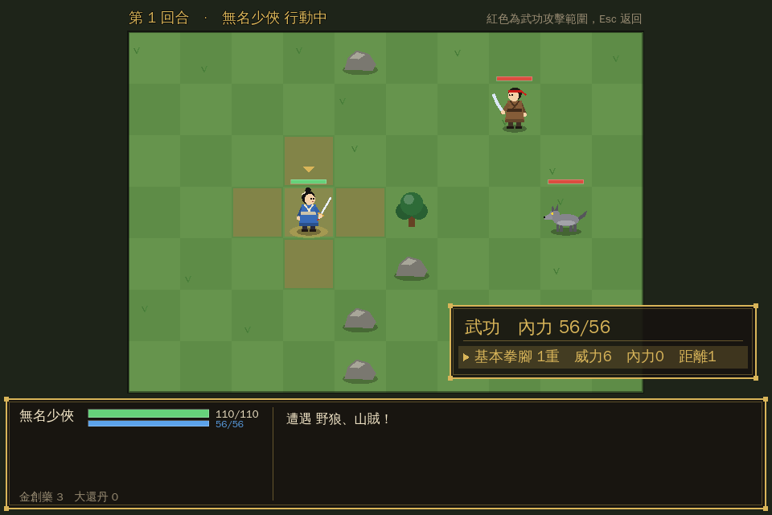

# 江湖俠客行（Godot 4 原創武俠 RPG）

參考經典武俠角色扮演遊戲的玩法類型（大地圖探索、拜師學武、戰棋式回合戰鬥、收集信物挑戰最終頭目）製作的**原創**小品遊戲。劇情、人物、武功與地圖都是原創的。



| 創角擲骰 | 大地圖 | 戰棋戰鬥 |
|---|---|---|
|  |  |  |

## 特色

- **全程式繪圖**：角色、地形、建築、特效都用 Godot 的 `_draw()` / `draw_*` API 即時畫出來，不需要任何圖片檔（`scripts/art.gd`、`scripts/map_layer.gd`）。
- **合成音效與背景音樂**：以五聲音階（宮商角徵羽）模擬古箏撥弦，執行時合成標題、大地圖、戰鬥三首循環配樂，以及出招、受擊、暴擊、療傷、升級等 13 種音效（`scripts/audio.gd`），一樣不需要音檔。
- **進度資料庫**：`SaveDB` 把資料存在 `user://jianghu_save_db.json`，分成兩張表：
  - `slots`：自動存檔＋三個手動存檔欄位，保存完整遊戲狀態；
  - `history`：**每次存檔都新增一筆進度紀錄**（時間、事件、等級、地點、銀兩、武林令），標題畫面的「進度紀錄」可以查看。
  - 會自動存檔的時機：踏入江湖、客棧歇息、每場戰鬥勝利／戰敗、通關。
- **玩法**：四項天賦擲骰（臂力／根骨／身法／悟性）、隨機遇敵、5 種可修練到第 10 重的武功、同伴加入、3 場頭目戰與結局。

## 遊玩方式

1. 安裝 [Godot 4.3 以上版本](https://godotengine.org/download)（標準版即可）。
2. 在 Godot 專案管理員選擇「匯入」，指向本資料夾的 `project.godot`。
3. 按 F5 執行。

| 按鍵 | 功能 |
|---|---|
| 方向鍵 / WASD | 移動、選擇 |
| Enter / 空白鍵 / Z | 確認、與據點互動 |
| Esc / X | 取消、開啟江湖選單（狀態、行囊、存讀檔） |
| R | 創角時重新擲骰 |
| M | 背景音樂開關 |

**攻略提示**：先在清風鎮附近練到 Lv2～3 → 青雲寺學流雲掌 → 劍廬學清風劍法 → 挑戰黑風寨（東北）與幽冥洞（東南）取得兩枚武林令 → 酒館邀請林小雨同行 → 登上赤霞峰決戰。

## 測試

```bash
godot --headless --path wuxia_game -s res://tests/test_runner.gd
```

自動檢查地圖連通性、角色成長、傷害公式、存讀檔往返與資料庫紀錄、所有腳本能否編譯（目前 111 項全數通過）。

```bash
godot --path wuxia_game -s res://tests/smoke_play.gd -- ./shots
```

實機冒煙測試：以模擬按鍵走過 標題 → 創角 → 大地圖 → 存檔 → 打完一場戰鬥，並輸出截圖。

## 專案結構

```
wuxia_game/
├── project.godot / main.tscn   # 專案設定與主場景
├── scripts/
│   ├── game.gd       # 遊戲狀態與規則（地圖、武功、敵人、成長）— 自動載入 Game
│   ├── save_db.gd    # 進度資料庫 — 自動載入 SaveDB
│   ├── audio.gd      # 音效與配樂合成 — 自動載入 Audio
│   ├── art.gd        # 程式繪圖美術
│   ├── map_layer.gd  # 大地圖地形繪製
│   ├── ui.gd / menu.gd
│   └── screens/      # title、create、world、battle、ending 五個畫面
└── tests/            # 自動測試與實機冒煙測試
```
